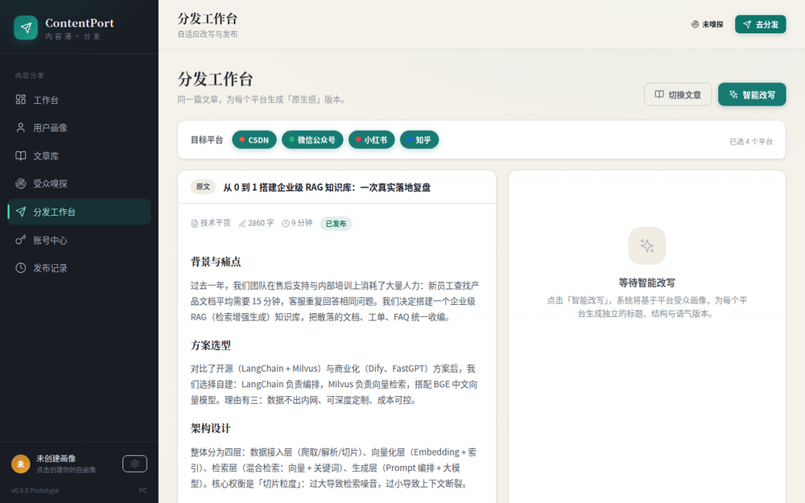
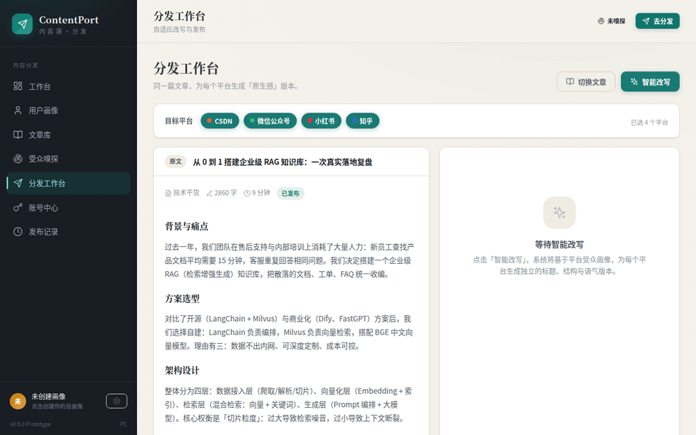

# ContentPort · 内容港

> 一篇文章，分发到 CSDN / 微信公众号 / 小红书 / 知乎 —— 不是简单的搬运，而是为每个平台的读者"量身改写"，让内容看起来就像平台原生的。

ContentPort（内容港）是一款 PC 桌面应用（Electron）。你只需把写好的一篇文章放进文章库，它会：

1. **嗅探** 四个平台的读者画像（年龄段、阅读习惯、内容偏好）
2. 基于你的 **用户画像** 和平台受众，为每个平台 **自动改写** 出独立的标题、结构与语气版本
3. 一键 **真实发布** 到四个平台（无需复制粘贴）
4. 发布后 **自动回拉** 阅读 / 点赞 / 评论数据，形成趋势曲线
5. 支持 **定时排队发布**，到点自动发出

---

## ✨ 功能特性

| 能力 | 说明 |
| --- | --- |
| 🎯 平台自适应改写 | 内容分析 → 平台规划 →（AI 计划 / 成稿 / 质检修复）→ 本地质检；为 CSDN/微信/小红书/知乎 各生成"原生感"版本，未配置 AI 时走确定性本地引擎 |
| 🔍 平台质检 | 信息保留 / 结构合规 / 长度 / 标题 / 原创度 / 可读性 / 平台合规 七维打分，附可执行的修复建议；分数是代理指标，不等于平台流量 |
| 📡 四平台真实发布 | CSDN（MetaWeblog）、微信公众号（官方 API，含封面图）、知乎（登录态接口）、小红书（浏览器自动填充发布，失败回退手动确认） |
| 📦 批量发布 | 一次把已改写平台依次发出，逐平台显示结果，单个失败不影响其他平台 |
| 📊 数据回拉 | 单条 / 批量 / 定时回拉阅读、点赞、评论；微信仅能回拉发布状态，小红书暂不支持回拉（界面会明确标注，不显示虚假 0） |
| 📈 数据趋势图表 | 工作台累计阅读曲线 + 单篇文章阅读/点赞/评论折线（纯 SVG 渲染，无需联网） |
| ⏰ 定时排队发布 | 设定未来时间 → 入队 → 到点自动发布；应用关闭期间不会执行，错过的任务会被标记 |
| 💾 本地持久化与备份 | 改写稿、文章库、发布记录、定时队列均落盘；支持导出 / 导入全量 JSON 备份（不含密钥） |
| 🔐 凭据加密 | 平台凭据与 AI Key 通过系统钥匙串（Keychain / DPAPI / libsecret）加密保存，明文不落盘 |
| 📚 文章库 | 正文编辑、标签、多分类筛选、拖拽排序、Markdown 复制稿导出 |
| 👤 用户画像 | 问答式自画像，让改写更懂你的创作定位 |

> 说明：受众页展示的是**内置平台画像基线**（受众、语气、结构偏好），不抓取平台实时数据；首次启动内置的样例文章与发布记录会明确标记为「演示」，可在工作台一键清空。

---

## 🎬 使用说明

### 1. 应用概览

点击侧边栏可切换七个核心页面：工作台、用户画像、文章库、受众嗅探、分发工作台、账号中心、发布记录。


### 2. 智能改写：一稿 → 多平台原生版本

在「分发工作台」选择目标平台后点击「智能改写」，系统会为每个平台独立生成标题、结构与语气版本，并给出适配度评分与调整清单；可在平台标签间切换对比。



### 3. 发布文章（立即 / 定时）

改写完成后点击「一键发布」，选择立即发布或定时发布。绑定平台账号后走真实 API 自动发布；未绑定账号时生成排版好的「复制稿」供手动粘贴，两种方式都不会丢内容。



---

## 🚀 快速开始

### 下载安装包（推荐）

到 [GitHub Releases](https://github.com/mw2wbyys6t-sudo/post-tailor/releases) 下载最新版本：

- `ContentPort-Win-x64-*.zip`：**Windows 便携版**（解压即用，无需安装）
- `ContentPort-Linux-x64-*.zip`：**Linux 便携版**

### 从源码运行

```bash
cd contentport
npm install
npm start          # 启动桌面应用
npm run dev        # 开发模式
npm run dist       # 打包当前平台安装包
```

---

## 📖 使用指南

### 第一步：建立用户画像（可选但推荐）

进入「用户画像」页回答问题（创作领域、目标读者、内容风格等），改写引擎会据此调整措辞与深度。

### 第二步：接入 AI（可选）

右上角 ⚙ 设置中填写 OpenAI 兼容接口：

- **Base URL**：如 `https://api.deepseek.com`
- **API Key**：你的密钥（保存进系统钥匙串，明文不落盘）
- **模型**：如 `deepseek-chat`

未配置 AI 时，改写会自动回退到内置确定性引擎，功能依然可用（只做结构与表达优化，不生成新论据）。

### 第三步：绑定平台账号

进入「账号中心」按平台登录（凭据加密存储，解绑即删除）：

| 平台 | 登录方式 | 发布通道 | 数据回拉 |
| --- | --- | --- | --- |
| CSDN | 用户名 + 密码 | MetaWeblog 接口直发 | 支持（解析文章页） |
| 微信公众号 | AppID + AppSecret | 官方素材 / 发布 API | 仅发布状态（阅读数据需图文分析权限） |
| 知乎 | 扫码登录 | 登录态 + 网页接口直发 | 支持 |
| 小红书 | 扫码登录 | 浏览器自动填充标题/正文并尝试发布，失败回退手动确认 | 暂不支持 |

### 第四步：导入文章并分发

1. 「文章库」→ 导入文章（支持 Markdown）
2. 「分发工作台」→ 选择目标平台 → **智能改写**
3. 逐平台对照预览与质检分项，满意后 **发布到当前平台** 或 **批量发布已改写平台**（也可选定时发布入队）

### 第五步：看数据

「发布记录」页可对每条记录回拉阅读/点赞/评论；开启「设置 → 数据自动回拉」后，应用会按设定间隔自动更新，并在工作台绘制累计阅读趋势曲线。尚未回拉或平台不提供数据的记录显示「—」，不会用 0 冒充真实数据。

### 第六步：备份数据

「设置 → 数据备份」或「发布记录 → 导出备份」可导出全量 JSON（文章、记录、改写稿、画像、定时队列），换机或重装后导入即可恢复；备份不含 AI Key 与平台凭据。

---

## 🧪 评测

仓库自带零依赖评测集（10 篇文章 × 4 平台），可对比新旧改写引擎：

```bash
cd contentport
npm run eval            # 新旧引擎对比 + 阈值检查（不达标退出码 1）
npm run eval:ai         # 走真实模型（需设置 AI_API_KEY / AI_BASE_URL / AI_MODEL）
npm run eval:baseline   # 刷新本地基线文件
npm run eval:calibrate -- --file=./history.json   # 用真实回拉数据做相关性校准
```

当前离线评测：四平台均值 93–95，相对旧规则引擎提升约 +10 ~ +14；P0 违规 0，长度合规 100%。

---

## 🛠 技术栈

- **桌面壳**：Electron 33（主进程代理 AI 与平台 API 请求，凭据经 safeStorage 加密）
- **前端**：原生 HTML / CSS / JavaScript（零框架，SPA + hash 路由）
- **图表**：纯 SVG 手绘折线图（无第三方图表库）
- **改写引擎**：`js/engine/` 六个零依赖模块（分析 / 策略 / 规划 / 成稿 / 质检 / 流水线），浏览器与 Node 共用
- **平台通道**：`electron/platform/` 下四个独立模块，统一 `verifyLogin / publish / fetchStats` 接口

## 📁 目录结构

```
contentport/
├── electron/
│   ├── main.js              # 主进程：IPC 代理、凭据保险库、扫码登录、小红书发布
│   ├── preload.js           # contextBridge 暴露安全接口
│   └── platform/
│       ├── csdn.js          # CSDN MetaWeblog 通道
│       ├── wechat.js        # 微信公众号官方 API 通道
│       ├── zhihu.js         # 知乎登录态接口通道
│       └── xhs.js           # 小红书登录态校验通道
├── js/
│   ├── engine/              # 改写算法：analysis / strategies / planner / writer / quality / pipeline
│   ├── mock.js              # 平台画像与演示数据
│   ├── state.js             # 本地状态、持久化、备份恢复
│   ├── api.js               # 业务 API（改写 / 发布 / 回拉 / 保险库）
│   ├── rewrite.js           # 旧规则引擎（仅保留作评测基线）
│   ├── ui.js                # UI 工具（图标 / 弹窗 / 图表）
│   └── pages/               # 七个页面
├── eval/                    # 零依赖评测集与命令行工具
├── docs/demo/               # 使用说明 GIF
└── index.html / styles.css
```

## ⚠️ 说明

- **小红书**：无第三方开放发布 API，本应用采用浏览器自动填充（复用扫码登录态操作官方发布页）；缺图片或页面改版时会回退为手动确认，正文放入剪贴板，不会丢内容。小红书目前**不支持数据回拉**。
- **微信公众号**：阅读/点赞数据需要「图文分析」接口权限，普通账号拿不到，因此只回拉发布/审核状态。
- **定时发布**：依赖应用运行中，关闭应用不会在后台执行；启动时会把已错过的任务标记为「已错过」。
- **质检分**：是可测量的代理指标（钩子、结构、信息保留、原创度、合规），不代表平台实际流量，也不承诺爆款。
- 各平台接口与页面结构会随平台方调整，遇到发布异常请升级到最新版本。

## 📄 License

[MIT](LICENSE)
